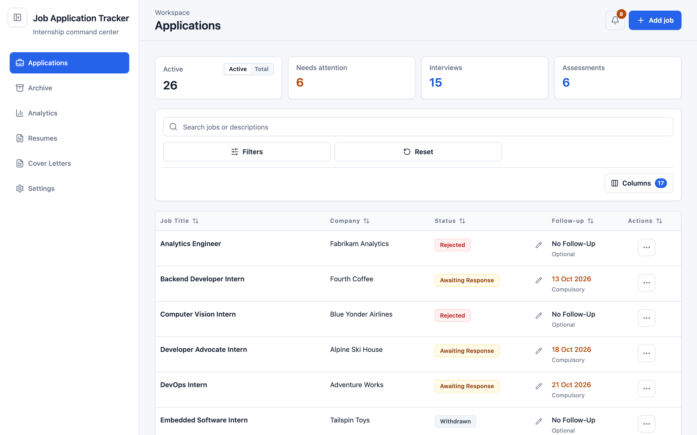
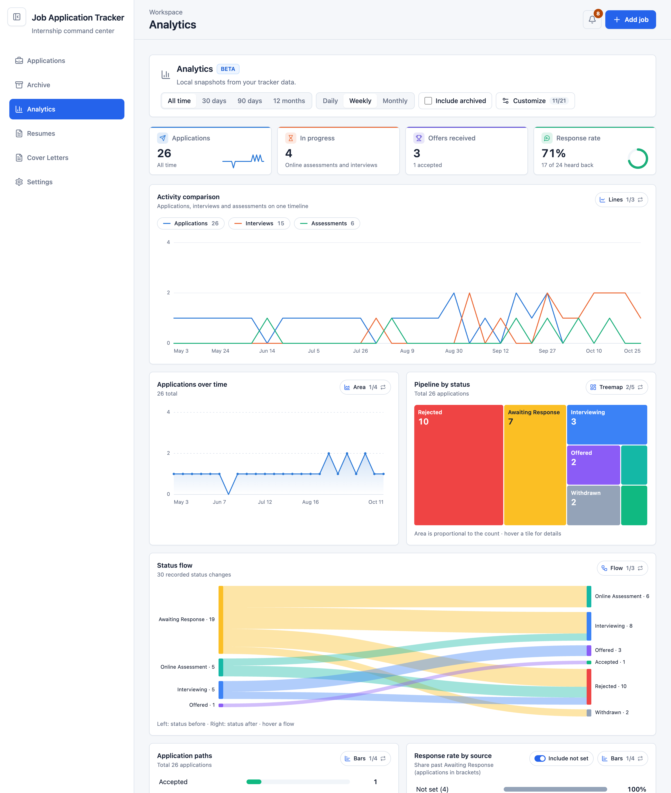
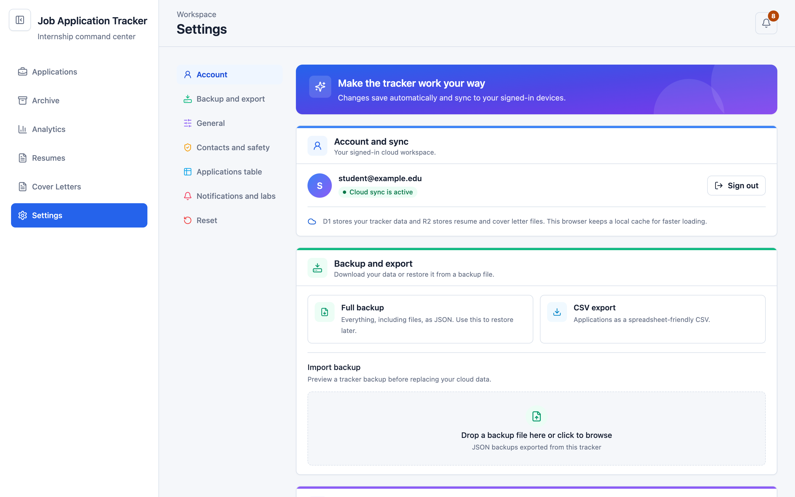
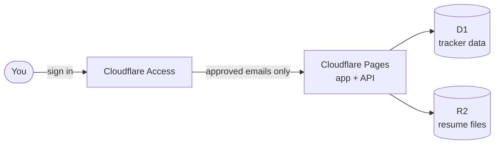

<div align="center">

# 📋 Job Application Tracker

**A private, self-hosted command center for internship and job applications.**

Track every application, follow-up, interview, and offer in one place, hosted on
your own Cloudflare account where only the people you allow can sign in.

[](https://github.com/Simplificatedd/JobApplicationTracker/actions/workflows/ci.yml)
[](LICENSE)


[Features](#-features) · [Quickstart](#-quickstart-host-your-own-private-tracker) · [Local development](#-local-development) · [Docs](#-documentation) · [FAQ](#-faq)



</div>

## ✨ Features

<table>
  <tr>
    <td width="33%" valign="top">
      <h3>🗂️ Applications table</h3>
      Search, filter, and sort with a sticky header, pinned columns, quick-edit
      popovers, resizable columns, and mobile cards. Keep contacts per
      application, and archive or restore entries.
    </td>
    <td width="33%" valign="top">
      <h3>🔔 Reminders</h3>
      Follow-ups, interview and assessment deadlines, and pending offers
      surface in a notification bell and a <em>Needs attention</em> focus mode.
    </td>
    <td width="33%" valign="top">
      <h3>📊 Analytics (beta)</h3>
      Key metrics, date ranges, and charts you can switch between views:
      bars, treemaps, donuts, timelines, a status flow, and more. Turn it on
      in <strong>Settings → Notifications and labs</strong>.
    </td>
  </tr>
  <tr>
    <td width="33%" valign="top">
      <h3>🗓️ Interviews &amp; assessments</h3>
      Multiple interview rounds and online assessments per application, each
      with its own schedule and deadline, plus assessment progress and
      results.
    </td>
    <td width="33%" valign="top">
      <h3>📄 Resume library</h3>
      Upload PDF and DOCX resumes and cover letters, label versions, and link
      them to the applications that used them.
    </td>
    <td width="33%" valign="top">
      <h3>🔐 Private &amp; portable</h3>
      Sign-in through Cloudflare Access, per-user data isolation, full JSON
      backups, and CSV export.
    </td>
  </tr>
</table>

<table>
  <tr>
    <td width="50%" valign="top"></td>
    <td width="50%" valign="top"></td>
  </tr>
  <tr>
    <td align="center"><sub>Analytics dashboard</sub></td>
    <td align="center"><sub>Settings</sub></td>
  </tr>
</table>

<sub>Screenshots use fictional demo data.</sub>

## 🚀 Quickstart: host your own private tracker

Deploy your own copy to **Cloudflare Pages** behind **Cloudflare Access**, so the
site asks for a sign-in and only the email addresses you approve can open it.
Personal use should fit within Cloudflare's free allowances.



**You need:** a free [Cloudflare account](https://dash.cloudflare.com/sign-up), a
GitHub account, and [Node.js 22](https://nodejs.org/).

> [!NOTE]
> Cloudflare may ask you to add a payment method before it enables R2 or Zero
> Trust, even on the free plans. Usage within the free allowances is not
> charged. See [usage limits](docs/privacy-and-security.md#cost-and-usage-guardrails).

### 1. Fork and verify the project

Select **Fork** at the top of this page, then clone your fork:

```bash
git clone https://github.com/<your-username>/JobApplicationTracker.git
cd JobApplicationTracker
nvm use            # or make sure `node --version` reports 22
npm ci
npm run check
```

Continue once `npm run check` passes.

### 2. Create the database and file storage

In the Cloudflare dashboard, open **Storage & Databases**:

1. Create a **D1** database named `job-application-tracker` and copy its
   database ID.
2. Create an **R2** bucket named `job-application-tracker-resumes`. Keep the
   **Standard** storage class and leave public access **off**.

Then create the database tables from your terminal. First copy the config:

```bash
cp wrangler.example.jsonc wrangler.jsonc
```

Open `wrangler.jsonc` and replace `replace-with-your-d1-database-id` with your
D1 database ID. Then sign in and apply the migrations:

```bash
npx wrangler login
npx wrangler d1 migrations apply job-application-tracker --remote
```

`wrangler login` opens a browser to approve access. Check that the migration
targets the Cloudflare account you expect, then answer `Yes` when asked.

### 3. Create the Pages site

Open **Workers & Pages → Create application → Pages → Connect to Git**, pick your
fork, and use these build settings:

| Setting | Value |
| --- | --- |
| Production branch | `main` |
| Build command | `npm run build` |
| Build output directory | `dist` |

Deploy, then note your address, for example `https://<your-project>.pages.dev`.
The site loads but cannot save or load data yet. That is expected until
steps 4 to 7 are done.

> [!TIP]
> Use **Connect to Git**, not Direct Upload. Every later push to `main` then
> redeploys automatically.

### 4. Put the site behind Cloudflare Access

1. If you have never used **Zero Trust**, open it from the dashboard once to
   set it up: choose a team name (it becomes
   `<your-team>.cloudflareaccess.com`) and select the **Free** plan.
2. In your Pages project, open **Settings → General** and select
   **Enable access policy**, then **Manage**.
3. Under **Destinations / Public hostnames**, clear the subdomain (delete the
   `*`) so the destination is exactly `<your-project>.pages.dev`. Rename the
   application if Cloudflare reports a naming conflict.
4. Add a policy with action **Allow** and **Include → Emails** set to your email
   address (and anyone else you want to let in).
5. Under **Authentication**, choose **One-time PIN**. Access emails a short code
   to approved addresses, so no other login setup is needed. If One-time PIN is
   not listed, add it under **Zero Trust → Integrations → Identity providers**
   first.
6. Save, then use **Policy tester** with your email to confirm you are allowed.

> [!WARNING]
> Never use **Everyone**, an email wildcard, **Bypass**, or **Service Auth** in
> this policy. Any of them would make your tracker reachable by people you did
> not approve.

### 5. Copy your two Access values

| Value | Where to find it |
| --- | --- |
| Team domain | **Zero Trust → Settings → Team name and domain**, written as `https://<your-team>.cloudflareaccess.com` |
| Application Audience (AUD) tag | **Zero Trust → Access controls → Applications →** your `<your-project>.pages.dev` application **→ Configure → Additional settings** (called **Details** in some layouts) |

These let the server verify that every request really came through your Access
sign-in.

### 6. Connect storage and secrets

In **Workers & Pages → your project → Settings**, add these to the
**Production** environment. Bindings go under **Bindings**; the two values go
under **Variables and Secrets**.

| Type | Name | Value |
| --- | --- | --- |
| D1 database binding | `DB` | `job-application-tracker` |
| R2 bucket binding | `RESUME_FILES` | `job-application-tracker-resumes` |
| Variable or secret | `TEAM_DOMAIN` | `https://<your-team>.cloudflareaccess.com` |
| Variable or secret | `POLICY_AUD` | the AUD tag from step 5 |

### 7. Redeploy and check

Bindings take effect on the next deployment. Open **Deployments**, retry the
latest `main` deployment, then visit your site:

- [ ] The site asks you to sign in before showing anything.
- [ ] After signing in, **Settings** shows **Cloud sync is active** with your email.
- [ ] A test application is still there after a refresh.
- [ ] Delete the test application before you start using or sharing the site.

🎉 **Done.** Your tracker is live at `https://<your-project>.pages.dev`, and only
the emails in your Allow policy can open it.

<details>
<summary><strong>Going further</strong></summary>

- Sign in with Google or your Cloudflare account instead of a PIN, protect
  preview deployments, or deploy from GitHub Actions to an existing Direct
  Upload project: see the [full deployment guide](docs/deployment.md).
- Something not working? Check [troubleshooting](docs/troubleshooting.md).

</details>

## 💻 Local development

Use Node.js 22 (see `.nvmrc`). Local sign-in uses `LOCAL_DEV_AUTH_EMAIL`, which
only works on `localhost`. The placeholder database ID in the example config is
fine locally; you only need a real D1 ID to deploy.

```bash
nvm use
npm ci
cp wrangler.example.jsonc wrangler.jsonc
cp .dev.vars.example .dev.vars
npx wrangler d1 migrations apply job-application-tracker --local
npm run dev            # app + API at http://localhost:8788
```

`npm run dev:ui` starts only the Vite frontend for isolated UI work. Before
committing or deploying, run the same gate as CI:

```bash
npm run check          # typecheck, lint, tests, and production builds
```

Never commit real resumes, exported backups, `.dev.vars`, or `wrangler.jsonc`.

## 📚 Documentation

| Guide | What it covers |
| --- | --- |
| [Deployment guide](docs/deployment.md) | Every Cloudflare step in detail, login options, previews, and GitHub Actions deploys |
| [Privacy, security, and limits](docs/privacy-and-security.md) | How sign-in and storage work, privacy notes, and usage guardrails |
| [Data model](docs/data-model.md) | How follow-ups, statuses, deadlines, deletion, and resumes behave |
| [Backups and recovery](docs/backups.md) | Restore limits, recovery archives, and oversized legacy-file extraction |
| [Document storage recovery](docs/document-storage-recovery.md) | Durable uploads, reference-safe cleanup, retries, and migration requirements |
| [Online assessments](docs/online-assessments.md) | How assessments work, plus their storage, migration, and backup compatibility |
| [Troubleshooting](docs/troubleshooting.md) | Common deployment problems and fixes |

## ❓ FAQ

<details>
<summary><strong>Is it really free?</strong></summary>

For personal use, yes. Pages, D1, R2 (Standard storage), and Access on the
Zero Trust free plan all have free allowances, and the app enforces its own
conservative limits so it fails safely instead of running up usage. Cloudflare
may still ask for a payment method to enable some products. See
[usage limits](docs/privacy-and-security.md#cost-and-usage-guardrails).

</details>

<details>
<summary><strong>Can friends or classmates use my deployment?</strong></summary>

Yes. Add their emails to the Access Allow policy. Each person's tracker data and
files are kept separate by their verified sign-in, so nobody sees anyone else's
applications.

</details>

<details>
<summary><strong>How do I get updates?</strong></summary>

Use **Sync fork** on your GitHub fork. Cloudflare Pages redeploys `main`
automatically. If an update adds a database migration, run the migration
command from step 2 again.

</details>

<details>
<summary><strong>How do I move my data to a new deployment?</strong></summary>

Open **Settings → Backup and export → Full backup** on the old site, then import
that file from the same section after signing in to the new one.

</details>

## 🤝 Contributing

Issues and pull requests are welcome. Keep commits small and focused, and make
sure `npm run check` passes before opening a pull request.

## 📄 License

[MIT](LICENSE)
