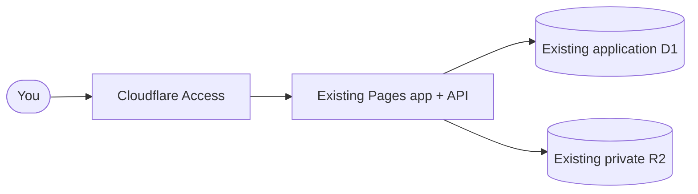

<div align="center">

# 📋 Job Application Tracker

**A private, self-hosted command center for internship and job applications.**

Track every application, follow-up, interview, and offer in one place, hosted on
your own Cloudflare account where only the people you allow can sign in.

[](https://github.com/Simplificatedd/JobApplicationTracker/actions/workflows/ci.yml)
[](LICENSE)


[Features](#-features) · [Deployment](#-production-deployment) · [Local development](#-local-development) · [Docs](#-documentation) · [FAQ](#-faq)


</div>

## ✨ Features

<table>
  <tr>
    <td width="33%" valign="top">
      <h3>🗂️ Applications table</h3>
      Search, filter, and sort with a sticky header, pinned columns, quick-edit
      popovers, resizable columns, and mobile cards. Keep contacts per
      application, and archive or restore entries.
    </td>
    <td width="33%" valign="top">
      <h3>🔔 Reminders</h3>
      Follow-ups, interview and assessment deadlines, and pending offers
      surface in a notification bell and a <em>Needs attention</em> focus mode.
    </td>
    <td width="33%" valign="top">
      <h3>📊 Analytics (beta)</h3>
      Key metrics, date ranges, and charts you can switch between views:
      bars, treemaps, donuts, timelines, a status flow, and more. Turn it on
      in <strong>Settings → Notifications and labs</strong>.
    </td>
  </tr>
  <tr>
    <td width="33%" valign="top">
      <h3>🗓️ Interviews &amp; assessments</h3>
      Multiple interview rounds and online assessments per application, each
      with its own schedule and deadline, plus assessment progress and
      results.
    </td>
    <td width="33%" valign="top">
      <h3>📄 Resume library</h3>
      Upload PDF and DOCX resumes and cover letters, label versions, and link
      them to the applications that used them.
    </td>
    <td width="33%" valign="top">
      <h3>🔐 Private &amp; portable</h3>
      Sign-in through Cloudflare Access, per-user data isolation, full JSON
      backups, and CSV export.
    </td>
  </tr>
</table>

<table>
  <tr>
    <td width="50%" valign="top"></td>
    <td width="50%" valign="top"></td>
  </tr>
  <tr>
    <td align="center"><sub>Analytics dashboard</sub></td>
    <td align="center"><sub>Settings</sub></td>
  </tr>
</table>

<sub>Screenshots use fictional demo data.</sub>

## 🚀 Production deployment

The tracker needs **one Cloudflare Pages project, one application D1 database,
and one private R2 bucket**, protected by the existing Cloudflare Access login.
Reuse the existing production resources; code deployment does not migrate or
replace their data. No control database, bootstrap, drain ledger, or hosted
preview storage is required.



Follow the [short production configuration checklist](docs/deployment.md).
GitHub CI checks pull requests and main without deploying. A separate manual
workflow deploys only a confirmed current main SHA, checks the existing resource
bindings, and serializes deployments. Preview publishing is disabled; do not
bind preview code to production storage. Merging a PR does not deploy it.

## 💻 Local development

Use Node.js 22.23.4 and its bundled npm 10.9.9 (see `.nvmrc`).
Local sign-in uses `LOCAL_DEV_AUTH_EMAIL`, which
only works on `localhost`. The placeholder database ID in the example config is
fine locally; production uses the existing verified application database and
bucket, with dashboard bindings rather than a committed local config.

```bash
nvm install
nvm use
npm ci
cp wrangler.example.jsonc wrangler.jsonc
cp .dev.vars.example .dev.vars
npx wrangler d1 migrations apply job-application-tracker --local
npm run dev            # app + API at http://localhost:8788
```

Local development uses local D1/R2 emulation; do not use remote flags or connect
local tests to production resources. No admission setup is required.

`npm run dev:ui` starts only the Vite frontend for isolated UI work. Before
committing or deploying, run the same gate as CI:

```bash
npm run check          # typecheck, lint, tests, and production builds
```

Never commit real resumes, exported backups, `.dev.vars`, or `wrangler.jsonc`.

## 📚 Documentation

| Guide | What it covers |
| --- | --- |
| [Deployment guide](docs/deployment.md) | Existing production resources, short setup checklist, manual deployment and recovery |
| [Privacy, security, and limits](docs/privacy-and-security.md) | How sign-in and storage work, privacy notes, and usage guardrails |
| [Data model](docs/data-model.md) | How follow-ups, statuses, deadlines, deletion, and resumes behave |
| [Backups and recovery](docs/backups.md) | Restore limits, recovery archives, and oversized legacy-file extraction |
| [Online assessments](docs/online-assessments.md) | How assessments work, plus their storage, migration, and backup compatibility |
| [Troubleshooting](docs/troubleshooting.md) | Common deployment problems and fixes |

## ❓ FAQ

<details>
<summary><strong>Is it really free?</strong></summary>

For personal use, yes. Pages, D1, R2 (Standard storage), and Access on the
Zero Trust free plan all have free allowances, and the app enforces its own
conservative limits so it fails safely instead of running up usage. Cloudflare
may still ask for a payment method to enable some products. See
[usage limits](docs/privacy-and-security.md#cost-and-usage-guardrails).

</details>

<details>
<summary><strong>Can friends or classmates use my deployment?</strong></summary>

Yes. Add their emails to the Access Allow policy. Each person's tracker data and
files are kept separate by their verified sign-in, so nobody sees anyone else's
applications.

</details>

<details>
<summary><strong>How do I get updates?</strong></summary>

Review updates in a PR and run CI. For the existing Direct Upload project,
merging changes source only; use the separately approved manual production
workflow after checking backups and resource bindings. Application schema changes
need their own review and authorization; deployment never runs migrations.

</details>

<details>
<summary><strong>How do I move my data to a new deployment?</strong></summary>

Open **Settings → Backup and export → Full backup** on the old site, then import
that file from the same section after signing in to the new one.

</details>

## 🤝 Contributing

Issues and pull requests are welcome. Keep commits small and focused, and make
sure `npm run check` passes before opening a pull request.

### Tech stack and source layout

The frontend uses React, TypeScript, Vite and Tailwind CSS, with Lucide icons.
Cloudflare Pages serves the app and Pages Functions API. Cloudflare Access
provides sign-in; the API verifies identity and isolates each user's D1 records
and private R2 documents. IndexedDB caches cloud data in the browser.

- `src/features/` — applications, resumes, settings and optional analytics.
- `src/components/`, `src/hooks/`, `src/lib/` — shared UI, hooks and domain helpers.
- `src/store/`, `src/storage/` — tracker actions, cloud API, browser cache and restore logic.
- `functions/` — API routes, authentication, validation and storage limits.
- `migrations/` — application D1 schema; code deployment does not apply migrations.
- `scripts/` — offline recovery and deployment verification utilities.
- `docs/` — existing [data model](docs/data-model.md), [security](docs/privacy-and-security.md),
  [backup](docs/backups.md) and [deployment](docs/deployment.md) guides.

Vitest tests live beside the code they cover; shared test helpers are in
`src/test/`. `npm run check` runs typecheck, lint, tests and builds. CI also runs
`python3 -B -m unittest discover -s scripts -p 'test_*.py'` for recovery and workflow checks.

## 📄 License

[MIT](LICENSE)
